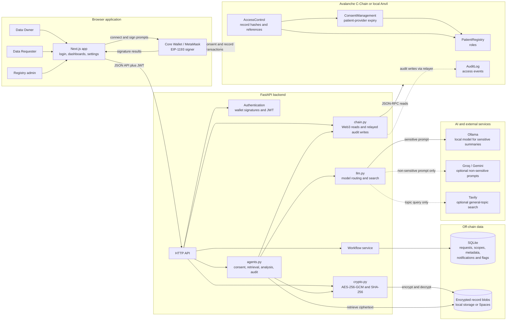
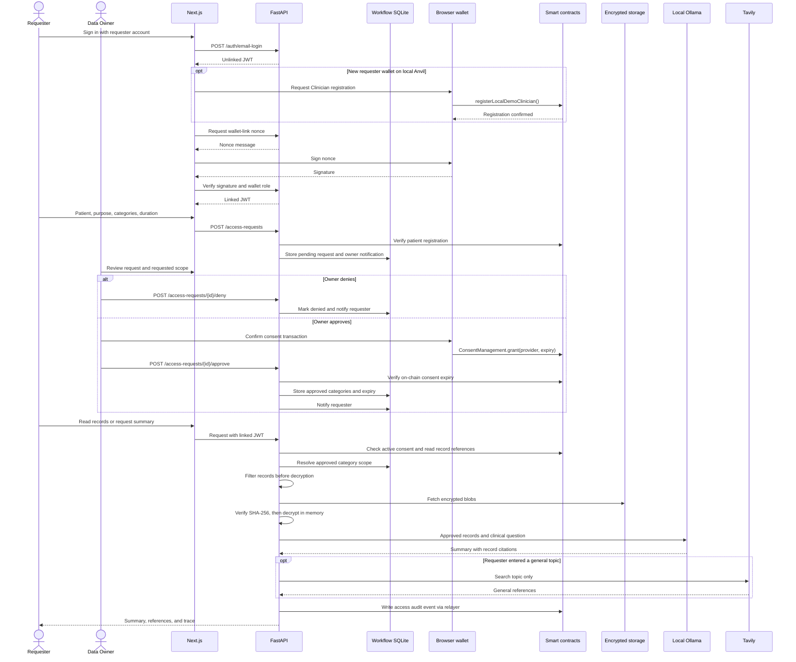
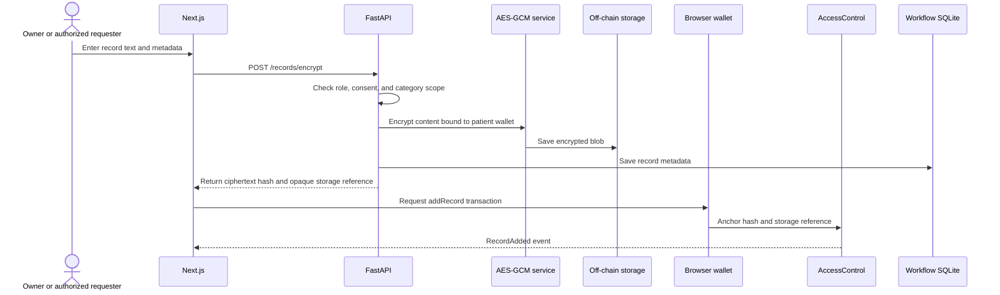

# MzansiHealthChain: Architecture and Workflows

This document describes the implemented application: role-based dashboards, consent and record workflows, the backend, smart contracts, off-chain storage, and AI integrations.

## System architecture

## Access request and summary workflow

## Record creation and storage

## Authorization and data boundaries

- The owner signs consent grants and revocations. The backend and AI agents cannot change consent.
- `AccessControl` stores hashes and opaque references, not record contents. Record blobs are encrypted off-chain.
- The contract consent is patient-provider wide. Category-level scope and expiry are additionally enforced by the backend workflow store before records are decrypted.
- Sensitive summary prompts use local Ollama. Groq and Gemini are available only for non-sensitive prompts; the current patient-record summary path does not send records to them.
- Tavily receives the optional topic query, not retrieved record content. Keep that topic generic and do not enter patient identifiers.
- AI output is assistive and must be checked against source records. Agents cannot approve requests, grant access, or write records.
- `registerLocalDemoClinician()` is restricted to chain ID `31337`; public-chain provider registration remains an administrator operation.

## Role capabilities

| Capability | Data Owner / Patient | Data Requester / Clinician | Registry admin | Backend relayer |
|---|---|---|---|---|
| Upload records | Own records | With active consent and approved category | | |
| Request access | | Yes, with purpose, categories, and duration | | |
| Approve, deny, or revoke access | Own records only | | | |
| View records and request summaries | Own records | Approved scope only | | |
| Flag records, export, view audit | Own records | Own audited activity | | |
| Register patient wallet | Self-register on-chain | | | |
| Register providers | | Local Anvil self-registration only for demo | Register/remove providers | |
| Write audit events | | | | Yes |

## Code map

| Concern | Where |
|---|---|
| Identity and on-chain roles | `contracts/src/PatientRegistry.sol` |
| Consent grant, revoke, and expiry | `contracts/src/ConsentManagement.sol` |
| Record references and contract access checks | `contracts/src/AccessControl.sol` |
| Append-only access trail | `contracts/src/AuditLog.sol` |
| Wallet linking and JWTs | `backend/app/auth.py` |
| Chain reads and audit writes | `backend/app/chain.py` |
| AES-256-GCM and SHA-256 | `backend/app/crypto.py` |
| Requests, scopes, metadata, notifications, and flags | `backend/app/workflow.py` |
| Storage backends | `backend/app/storage.py` |
| Model routing and Tavily | `backend/app/llm.py` |
| Summary orchestration and agents | `backend/app/agents.py` |
| HTTP API and authorization gates | `backend/app/main.py` |
| Role dashboards and wallet helpers | `frontend/app/`, `frontend/lib/` |
